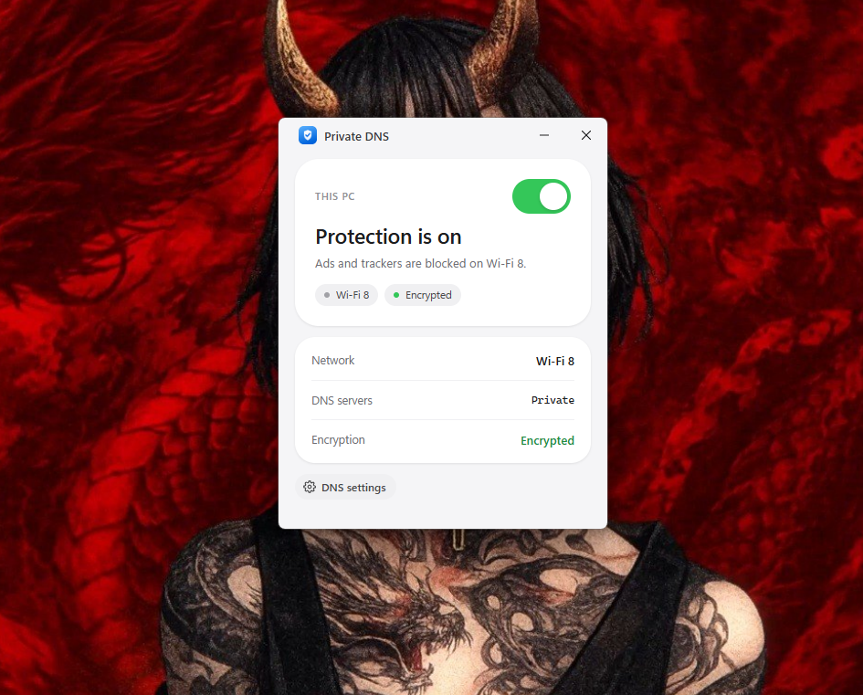

# Private DNS

**Blocks ads and trackers — including YouTube ads — on Windows, Android and iPhone.**

Private DNS blocks ads and trackers before they load. It runs as a system-wide DNS over HTTPS filter, so it works in every app and browser, on Wi-Fi and mobile data — not just inside one browser.

## What it does

- ✅ Blocks ads and trackers system-wide — not just inside one browser
- ✅ 🎬 Removes YouTube ads (pre-roll, mid-roll, banners) on PC, Android and iPhone
- ✅ Encrypts every DNS lookup with DNS over HTTPS, so your ISP or public Wi-Fi can't see the sites you open
- ✅ One on/off switch, no account and no subscription
- ✅ Works everywhere: Wi-Fi and mobile data, in every app and browser

## Supported devices

- 💻 Windows 10 / 11 — installer (~97 MB)
- 📱 Android 7.0+ — APK
- 🍏 iPhone iOS 14+ — configuration profile

## Download

All three files are on one page: **https://private-dns-amber.vercel.app/**

Open the link, pick your device, and install. Windows SmartScreen and Android's "install from this source" prompt will show because the builds are unsigned. Turning the switch off, or removing the profile in Settings, restores your previous DNS settings.

The same page is also served by GitHub Pages from this repository: https://jhonmark0.github.io/Private-DNS/
